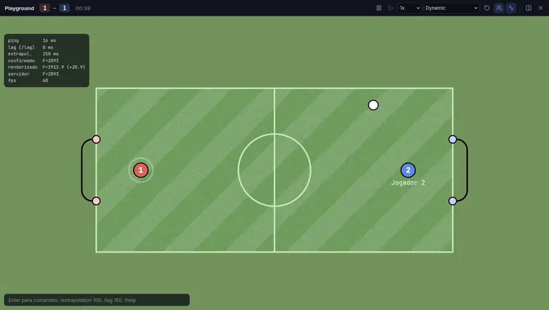

<div align="center">


# haxforge

[English](README.md) · [Português](README.pt-BR.md) · **Español**

**Editor visual y moderno de mapas de HaxBall que corre en el navegador.**<br>
Crea desde cero, genera una cancha en segundos o abre un `.hbs` y edítalo sin perder ni una coma del formato original.

[**Abrir el editor →**](https://pedrohfonseca81.github.io/haxforge/) · [**Comunidad en Discord →**](https://discord.gg/ZTu7zwgvhm)

[](https://discord.gg/ZTu7zwgvhm)
[](https://github.com/pedrohfonseca81/haxforge/actions/workflows/pages.yml)


</div>

## Lo que hace que otros editores no hacen

<table>
<tr>
<td width="50%" valign="top">

### Letreros de verdad

Escribe un texto y se convierte en segmentos sobre la cancha. La fuente propia, **Haxforge Sans**, está hecha de rectas y **arcos nativos de HaxBall**: una "O" cuesta solo 4 vértices y 4 segmentos y se ve suave en cualquier zoom. Rotación, curvatura (texto en arco), múltiples líneas, acentos, decorativo o sólido.

**46 fuentes** en una galería con vista previa de tu texto y el costo exacto en segmentos: 15 de trazo único (Hershey y EMS: sans, serif, cursivas, gótica, techno), 30 de Google Fonts (Bebas Neue, Anton, Press Start 2P, Pacifico…) y tus propias fuentes en TTF/OTF/WOFF.

</td>
<td width="50%"></td>
</tr>
<tr>
<td width="50%"></td>
<td width="50%" valign="top">

### Juega en el mapa sin salir del editor

El playground ejecuta la física y el netcode de HaxBall (vía [kickr](#créditos)) dentro del navegador, sin servidor. **`/extrapolation` y `/lag` funcionan de verdad**, mostrando ping, frame confirmado y frame renderizado en pantalla. Pausa, avance cuadro a cuadro, cámara lenta, **rebobinado de 10 s**, lanzador de pelota con trayectoria prevista y segundo jugador local.

</td>
</tr>
<tr>
<td width="50%" valign="top">

### Edición en vivo y linter de física

Editor y partido lado a lado: cada cambio recarga el mapa **sin detener el partido**. El linter detecta **huecos por donde la pelota o los jugadores se escapan** (usando el radio real de cada cuerpo y las mismas reglas de colisión de la física, incluidos extremos de segmento sin vértice), cuerpos que aparecen dentro de paredes, segmentos repetidos y más, con corrección en un clic.

</td>
<td width="50%"></td>
</tr>
</table>

## Todo lo que incluye

**Archivos sin pérdidas**
- Importar un `.hbs` y exportarlo sin tocar nada devuelve **exactamente el mismo archivo, byte por byte**: comentarios, sintaxis JSON5, traits, campos desconocidos y formato.
- Los elementos nuevos imitan el estilo del archivo (minificado, un objeto por línea o indentado). Los comentarios de índice (`/* 12 */`) se renumeran solos.

**Edición**
- **Herramientas:** segmento encadenado, vértice, disco, arco (gol), plano, joint y spawns.
- **Ajuste fino:** cuadrícula, imán en vértices, puntos medios e intersecciones, guías de alineación, `Shift` bloquea cada 15°, y puedes escribir la longitud (`120` o `120<45`). Curvar un segmento es arrastrar el rombo en su centro.
- **Capas = orden real de los arrays.** Reordenar remapea los índices `v0/v1` y `d0/d1` automáticamente.
- **Inspector:** muestra de dónde viene cada valor (objeto, trait o valor por defecto de HaxBall), con botón para restablecer y "aplicar al trait". Los campos numéricos aceptan cuentas (`370/2`) y arrastrar la etiqueta.
- **Medidor del límite de 255** por tipo, siempre visible.

**Objetos inteligentes** (guardan parámetros y se regeneran en su lugar)
- **Generador de cancha:** Classic, Big, Futsal, Real Soccer y Hockey/arena, ajustables con controles deslizantes. Los cinco pasan el linter sin huecos.
- **Simetría en vivo** (↔, ↕, 4 cuadrantes) y **repetición** en línea o en círculo: las copias siguen al original en cada edición, invirtiendo curvas, bias y equipos de forma correcta.
- **SVG e imágenes:** importados y redibujados con simplificación y arcos (un círculo cuesta 2 segmentos). Los PNG/JPG se trazan antes con vista previa en vivo.
- **Patrones:** césped a rayas, cuadrícula y puntos en arco.
- **Optimizador:** une vértices repetidos, fusiona segmentos colineales, cambia polilíneas por arcos (un anillo de 36 segmentos pasa a 2) y muestra el ahorro antes de aplicar.

**Física a la vista** (menú Física)
- Colores por colisión: qué frena cada pared.
- Grosor y lado del bias.
- Pared inflada para la pelota o para un equipo (dónde no puede llegar el centro del cuerpo).

**Proyectos e Idiomas**
- Autoguardado en el navegador, deshacer ilimitado y **versiones** con restauración.
- **Enlace del mapa:** el `.hbs` comprimido en el propio enlace, sin servidor.
- Los estadios oficiales de HaxBall ya vienen como plantillas.
- **Bilingüe (Portugués / Inglés):** abre en portugués para usuarios en Brasil y en inglés para el resto de países, con selector de idioma en la barra superior.

<div align="center"></div>

## Atajos

| Tecla | Acción | Tecla | Acción |
|---|---|---|---|
| `V` | Seleccionar | `Ctrl+K` | Paleta de comandos |
| `S` | Segmento | `Ctrl+Enter` | Jugar |
| `X` | Vértice | `Ctrl+Shift+Enter` | Jugar lado a lado |
| `D` | Disco | `Ctrl+Z` / `Ctrl+Shift+Z` | Deshacer / rehacer |
| `G` | Gol | `Ctrl+D` | Duplicar |
| `P` | Plano | `Ctrl+E` | Exportar `.hbs` |
| `J` | Joint | `Shift+1` | Encuadrar el mapa |
| `R` / `B` | Spawn red / blue | `Espacio` + arrastrar | Mover la vista |
| `T` | Letrero | `Alt` + arrastrar | Duplicar arrastrando |

En el playground: flechas/WASD mueven y `X`/`Espacio` patean. `P` pausa, `.` avanza un frame y `Enter` abre los comandos (`/extrapolation`, `/lag`, `/speed`, `/reset`, `/p2`).

## Agentes de IA (WebMCP)

El editor registra **25 herramientas** para agentes de IA que corren en el navegador mediante [WebMCP](https://webmachinelearning.github.io/webmcp/) (`document.modelContext.registerTool`, con soporte también para el formato anterior `navigator.modelContext`).
- **Lo que un agente puede hacer:** leer el mapa y los problemas, generar cancha, dibujar, escribir letreros, espejar, optimizar, **simular tiros con la física real** y exportar.
- **Control:** cada acción del agente entra en el historial (`Ctrl+Z` deshace) y aparece en el panel del botón de robot, donde se puede desactivar.
- WebMCP aún es un borrador del W3C Community Group. Sin él en el navegador, nada cambia.

## Desarrollo

```sh
bun install
bun dev          # http://localhost:5174
bun test         # round trip sin pérdidas, física, linter, objetos inteligentes, i18n, WebMCP
bun run build    # sitio estático en dist/
```

Cada push a `main` publica el sitio en GitHub Pages ([`.github/workflows/pages.yml`](.github/workflows/pages.yml)).

<details>
<summary>Organización del código</summary>

- `src/doc/`: el documento.
  - `cst.ts`: parser JSON5 con árbol de sintaxis concreta.
  - `print.ts` y `style.ts`: impresión sin pérdidas.
  - `model.ts` y `ops.ts`: modelo y ediciones, con remapeo de índices.
  - `lint.ts`, `resolve.ts`, `fields.ts` y `bodies.ts`.
- `src/editor/`: estado e historial, herramientas, snap, canvas, acciones, versiones.
- `src/smart/`: objetos inteligentes.
  - `text.ts` y `font.ts`: letrero.
  - `field.ts`: generador de cancha.
  - `svg.ts` y `trace.ts`: dibujos e imágenes.
  - `pattern.ts`, `optimize.ts` y `smart.ts`.
- `src/play/`: playground (sala y cliente kickr en una red simulada, con reloj virtual y rebobinado).
- `src/agent/`: herramientas WebMCP.
- `src/persist/`: IndexedDB (proyectos, versiones, fuentes) y enlace del mapa.
- `src/ui/`: pantallas y paneles en Preact.
- `src/i18n.ts`: internacionalización (Brasil -> `pt`, otros países -> `en`).
- `src/vendor/kickr/`: motor de kickr (física idéntica a la de HaxBall, bit a bit). Ver `VENDOR.md`.

</details>

## Créditos

- Física, reglas, netcode y renderer clásico vienen de **kickr**, una reimplementación de HaxBall verificada bit a bit contra el original.
- Los estadios plantilla fueron exportados del propio HaxBall. **Futsal x3** es de Bazinga (HaxMaps).
- Las fuentes de trazo único son las **Hershey** (Dr. A. V. Hershey, U.S. National Bureau of Standards) y las **EMS** de Evil Mad Scientist (SIL OFL), mediante el paquete [hersheytext](https://github.com/techninja/hersheytextjs). Avisos completos en [`src/smart/STROKE_FONTS.md`](src/smart/STROKE_FONTS.md). Las fuentes de Google Fonts provienen del CDN de [Fontsource](https://fontsource.org).
- HaxBall es de Mario Carbajal (basro). haxforge es un proyecto independiente de fans.
