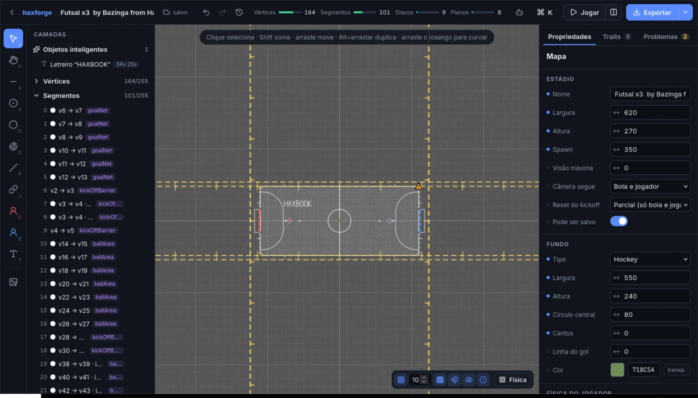
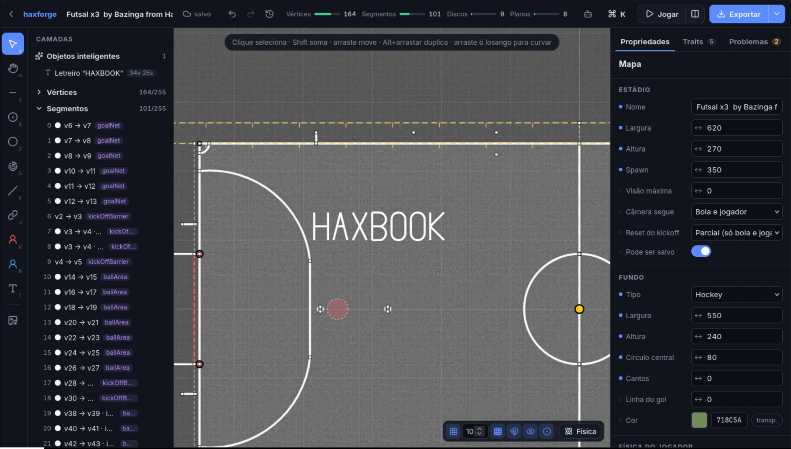
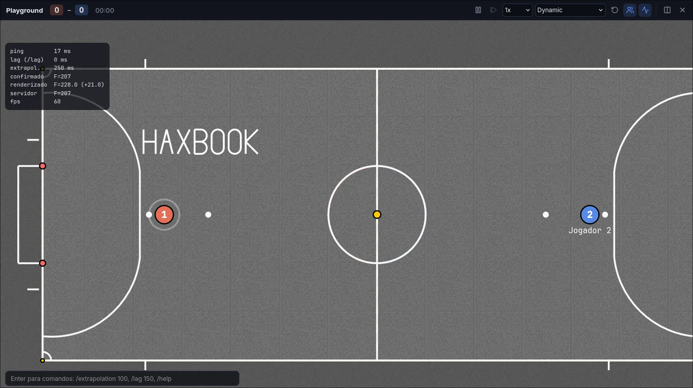
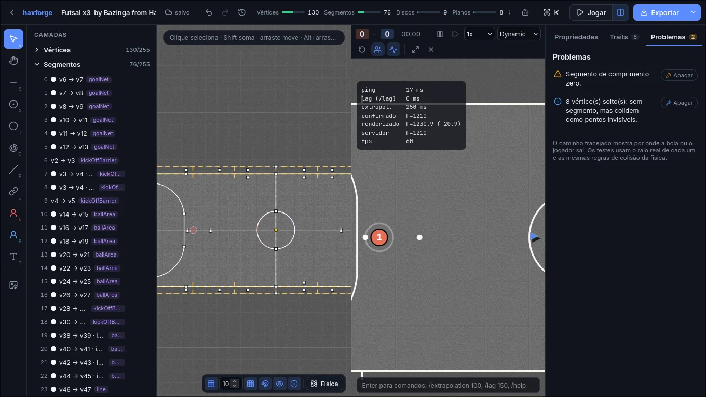
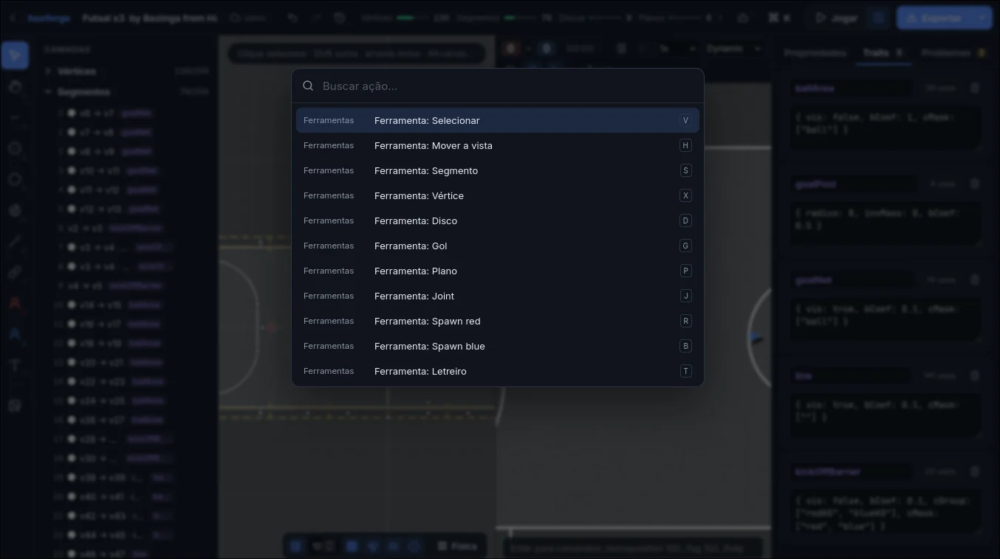

<div align="center">


# haxforge

[English](README.md) · **Português** · [Español](README.es.md)

**Editor de mapas do HaxBall, visual e moderno, que roda no navegador.**<br>
Crie do zero, gere um campo em segundos ou abra um `.hbs` e edite sem perder uma vírgula da formatação.

[**Abrir o editor →**](https://pedrohfonseca81.github.io/haxforge/) · [**Comunidade no Discord →**](https://discord.gg/ZTu7zwgvhm)

[](https://discord.gg/ZTu7zwgvhm)
[](https://github.com/pedrohfonseca81/haxforge/actions/workflows/pages.yml)



</div>

## O que ele faz que outros editores não fazem

<table>
<tr>
<td width="50%" valign="top">

### Letreiro de verdade

Digite um texto e ele vira segmentos no campo. A fonte própria, **Haxforge Sans**, é feita de retas e **arcos nativos do HaxBall**: um "O" custa 4 vértices e 4 segmentos e fica liso em qualquer zoom. Rotação, curvatura (texto em arco), várias linhas, acentos, decorativo ou sólido.

**46 fontes** numa galeria com prévia do seu texto e o custo em segmentos: 15 de traço único (Hershey e EMS: sans, serif, cursivas, gótica, techno), 30 do Google Fonts (Bebas Neue, Anton, Press Start 2P, Pacifico…) e as suas, em TTF/OTF/WOFF.

</td>
<td width="50%"></td>
</tr>
<tr>
<td width="50%"></td>
<td width="50%" valign="top">

### Jogue no mapa sem sair do editor

O playground roda a física e o netcode do HaxBall (via [kickr](#créditos)) dentro do navegador, sem servidor. **`/extrapolation` e `/lag` funcionam de verdade**, com ping, frame confirmado e renderizado na tela. Pausa, frame a frame, câmera lenta, **rewind de 10 s**, lançador de bola com trajetória prevista e segundo jogador local.

</td>
</tr>
<tr>
<td width="50%" valign="top">

### Edição ao vivo e linter de física

Editor e jogo lado a lado: cada edição recarrega o mapa **sem parar a partida**. O linter acha **vãos por onde a bola ou os jogadores escapam** (com o raio real e as mesmas regras de colisão da física, incluindo pontas de segmento sem vértice), corpos nascendo dentro de paredes, segmentos repetidos e mais, com correção em um clique.

</td>
<td width="50%"></td>
</tr>
</table>

## Tudo que tem

**Arquivo sem perdas**
- Importar um `.hbs` e exportar sem mexer devolve **o mesmo arquivo, byte a byte**: comentários, JSON5, traits, campos desconhecidos e formatação.
- O que é novo imita o estilo do arquivo (minificado, um objeto por linha ou indentado). Comentários de índice (`/* 12 */`) são renumerados.

**Edição**
- **Ferramentas:** segmento encadeado, vértice, disco, gol, plano, joint e spawns.
- **Ajuste fino:** grid, ímã em vértices, pontos médios e interseções, guias de alinhamento, `Shift` trava 15°, e dá pra digitar o comprimento (`120` ou `120<45`). Curvar é arrastar o losango no meio do segmento.
- **Camadas = ordem real dos arrays.** Reordenar remapeia os índices `v0/v1` e `d0/d1` sozinho.
- **Inspector:** mostra de onde vem cada valor (objeto, trait ou padrão do HaxBall), com resetar e "aplicar ao trait". Campos aceitam conta (`370/2`) e arrastar o rótulo.
- **Medidor do limite de 255** por tipo, sempre visível.

**Objetos inteligentes** (guardam parâmetros e se refazem no lugar)
- **Gerador de campo:** Classic, Big, Futsal, Real Soccer e Hockey/arena, em sliders. Os cinco passam no linter sem vãos.
- **Simetria ao vivo** (↔, ↕, 4 quadrantes) e **repetição** em linha ou em círculo: as cópias acompanham o original, e curvas, bias e times trocam do jeito certo.
- **SVG e imagens:** importados e redesenhados com simplificação e arcos (um círculo custa 2 segmentos). PNG/JPG são traçados antes, com prévia.
- **Padrões:** grama listrada, grade e pontos em arco.
- **Otimizador:** une vértices repetidos, funde segmentos em linha reta, troca polilinhas por arcos (um anel de 36 segmentos vira 2) e mostra a economia antes de aplicar.

**Física à vista** (botão Física)
- Cores por colisão: o que cada parede segura.
- Espessura e lado do bias.
- Parede inflada pra bola ou pra um time (onde o centro do corpo não chega).

**Projetos e Idiomas**
- Autosave no navegador, undo ilimitado e **versões** com restauração.
- **Link do mapa:** o `.hbs` comprimido no próprio link, sem servidor.
- Os estádios do HaxBall já vêm como modelos.
- **Bilíngue (Português / Inglês):** abre em português para quem está no Brasil e em inglês para outros países, com botão para alternar na barra superior.

<div align="center"></div>

## Atalhos

| Tecla | Ação | Tecla | Ação |
|---|---|---|---|
| `V` | Selecionar | `Ctrl+K` | Paleta de comandos |
| `S` | Segmento | `Ctrl+Enter` | Jogar |
| `X` | Vértice | `Ctrl+Shift+Enter` | Jogar lado a lado |
| `D` | Disco | `Ctrl+Z` / `Ctrl+Shift+Z` | Desfazer / refazer |
| `G` | Gol | `Ctrl+D` | Duplicar |
| `P` | Plano | `Ctrl+E` | Exportar `.hbs` |
| `J` | Joint | `Shift+1` | Enquadrar o mapa |
| `R` / `B` | Spawn red / blue | `Espaço` + arrastar | Mover a vista |
| `T` | Letreiro | `Alt` + arrastar | Duplicar arrastando |

No playground: setas/WASD andam e `X`/`Espaço` chutam. `P` pausa, `.` avança um frame e `Enter` abre os comandos (`/extrapolation`, `/lag`, `/speed`, `/reset`, `/p2`).

## Agentes de IA (WebMCP)

O editor registra **25 ferramentas** para agentes de IA que rodam no navegador, via [WebMCP](https://webmachinelearning.github.io/webmcp/) (`document.modelContext.registerTool`, com suporte também ao formato anterior `navigator.modelContext`).
- **O que um agente consegue:** ler o mapa e os problemas, gerar campo, desenhar, escrever letreiro, espelhar, otimizar, **simular chutes com a física real** e exportar.
- **Controle:** cada ação do agente entra no histórico (`Ctrl+Z` desfaz) e aparece no painel do botão de robô, onde dá pra desligar.
- WebMCP ainda é rascunho do W3C Community Group. Sem ele no navegador, nada muda.

## Desenvolvimento

```sh
bun install
bun dev          # http://localhost:5174
bun test         # round trip lossless, física, linter, objetos inteligentes, i18n, WebMCP
bun run build    # site estático em dist/
```

Cada push na `main` publica o site no GitHub Pages ([`.github/workflows/pages.yml`](.github/workflows/pages.yml)). O plano e as decisões de projeto estão em [PLAN.md](PLAN.md).

<details>
<summary>Organização do código</summary>

- `src/doc/`: o documento.
  - `cst.ts`: parser JSON5 com sintaxe concreta.
  - `print.ts` e `style.ts`: impressão sem perdas.
  - `model.ts` e `ops.ts`: modelo e edições, com remapeamento de índices.
  - `lint.ts`, `resolve.ts`, `fields.ts` e `bodies.ts`.
- `src/editor/`: estado e histórico, ferramentas, snap, canvas, ações, versões.
- `src/smart/`: objetos inteligentes.
  - `text.ts` e `font.ts`: letreiro.
  - `field.ts`: gerador de campo.
  - `svg.ts` e `trace.ts`: desenhos e imagens.
  - `pattern.ts`, `optimize.ts` e `smart.ts`.
- `src/play/`: playground (sala e cliente kickr numa rede simulada, com relógio virtual e rewind).
- `src/agent/`: ferramentas WebMCP.
- `src/persist/`: IndexedDB (projetos, versões, fontes) e link do mapa.
- `src/ui/`: telas e painéis em Preact.
- `src/i18n.ts`: internacionalização (Brasil -> `pt`, outros países -> `en`).
- `src/vendor/kickr/`: motor do kickr (física idêntica à do HaxBall, bit a bit). Veja `VENDOR.md`.

</details>

## Créditos

- Física, regras, netcode e renderer clássico vêm do **kickr**, uma reimplementação do HaxBall conferida bit a bit contra o original.
- Os estádios-modelo foram exportados do próprio HaxBall. O **Futsal x3** é do Bazinga (HaxMaps).
- As fontes de traço único são as **Hershey** (Dr. A. V. Hershey, U.S. National Bureau of Standards) e as **EMS** da Evil Mad Scientist (SIL OFL), pelo pacote [hersheytext](https://github.com/techninja/hersheytextjs). Avisos completos em [`src/smart/STROKE_FONTS.md`](src/smart/STROKE_FONTS.md). As fontes do Google Fonts vêm do CDN do [Fontsource](https://fontsource.org).
- HaxBall é de Mario Carbajal (basro). O haxforge é um projeto independente de fã.
